This keeb created by a group of people who loves keyball.

Special Thanks to:  
PCB: *[yangxing844](https://github.com/yangxing844)*  
Case: *[delock](https://github.com/delock)*  
Firmware: *[Amos698](https://github.com/Amos698)*  

## Mac and Windows input layouts

Use **U.S.** on macOS and **United States-International (QWERTY)** on Windows.
Windows can keep **English (United States)** as its input language; select the
**United States-International** keyboard with Win+Space.

The keyboard's mode key switches between **MAC** and **WIN**. Hold Space to open
**NUM** in Mac mode or **WNUM** in Windows mode. Both modes use the same QWERTZ
letter positions, independent of the host layout's QWERTY name.

NUM and WNUM have the same character positions and normal/Shift output, including
**ü/Ü, ö/Ö, ä/Ä, ß/Í, €**, and the digits and punctuation. The Ctrl-hold key at the
S position taps a backtick and produces a tilde with Shift in both modes.
Windows macros complete dead keys with Space so backticks, tildes, single and
double quotes, and Shift+6 (`^`) appear immediately without an extra space or
accenting the next letter. Keep Shift held until the macro finishes.

Home-row modifiers keep their existing hold behavior. The function layers use
the existing platform-specific shortcuts (for example, Command+C on Mac and
Ctrl+C on Windows); other modifier combinations follow the host OS.

After building and flashing, test both modes with each home-row Shift: umlauts
must capitalize, and typing a quote/backtick/caret followed by `a` must produce
two separate characters on Windows. Confirm the new firmware on the keyboard;
changing the Windows input layout alone does not update its key bindings.

## Bluetooth profile selection

Hold the former Bluetooth-next key (bottom left) and press a key in the right
top row to select a profile and its mode together:

| Key | Bluetooth profile | Mode |
| --- | --- | --- |
| P | 1 | WIN |
| O | 2 | WIN |
| I | 3 | MAC |
| U | 4 | WIN |
| Z | 5 | WIN |

The selector works from either mode. Z refers to the physical Z position in
the current base layout, next to U. Release the selector key to resume typing;
the chosen mode stays active. While holding it, you can select another profile.
Pressing the selector alone no longer cycles profiles. Other keys in the menu
are disabled to avoid typing to a device while choosing it.

